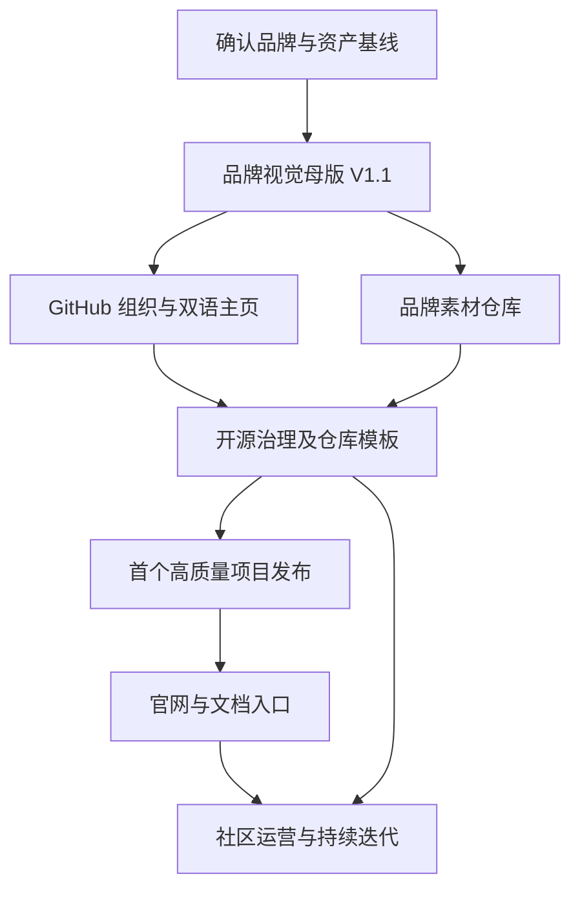

# Primordial Weave · 原初织界

> **Open-source ecosystem roadmap / 开源品牌与组织建设执行计划**  
> **版本：** v1.9 · 2026-11-07 标准 Mark V1.1 定稿与脚本可复现性验收  
> **制定日期：** 2026-10-25  
> **适用范围：** Primordial Weave 母品牌、GitHub 组织、品牌资源、开源项目及未来官网  
> **核心主张：** Inspired by ancient wisdom. Built for the open future.  
> **中文主张：** 灵感源自古老智慧，创造面向开放未来的工具。

## 0. 使用说明

本文件是一份**持续维护的执行计划**，而非已经完成的工作证明。历史 S0/S1/S3 报告链接涉及先前的对话交付归档，**本品牌仓库不包含这些旧报告文件**；本次仅将第10节的文档结构落到线上。它将品牌讨论和现有视觉规范落实为可追踪的任务、交付物、验收标准、依赖关系与里程碑。

- `[x]`：现阶段已经产出可供审阅的内容；**不等于已上线、已注册或已发布**。
- `[ ]`：尚未完成或仍需验证。
- **P0 / P1 / P2**：分别表示上线前必做、首批项目发布前应做、成熟期再做。
- **Gate**：进入下一阶段前必须达到的验收条件。
- **时间**：下文“第 1–2 周”等是规划节奏，按实际投入与条件灵活调整，不构成固定交付承诺。
- **身份信息**：组织 GitHub handle、域名、商标、许可证及实际仓库地址仍须以核实结果为准。文中 `<ORG_HANDLE>` 为实际组织名占位符，不应直接发布。

### 0.1 总体目标

建设一个以中国传统哲学和水墨美学为灵感、对国际开发者友好、拥有一致品牌语言与可持续开源工程实践的技术组织。核心是**让工具真正好用**，文化为识别与设计提供思想，而不是代替产品价值。

### 0.2 已确定 / 待最终核定

| 项目 | 当前状态 | 备注 |
|---|---|---|
| 品牌英文名 | ✅ 方向确认：**Primordial Weave** | 品牌英文拼写保持统一 |
| 品牌中文名 | ✅ 当前采用：**原初织界** | 作为品牌中文表达，并非古籍原词 |
| 品牌宣言 | ✅ 已拟定中英文版本 | 发布时逐字统一 |
| 核心视觉 | ✅ 选定“传统黑白太极 + 一笔墨环 + 克制朱砂” | AI 视觉稿≠正式矢量母版 |
| 辅助印章 | ◐ 「織」字朱砂篆意稿 | **小篆字形尚需考证并重绘** |
| 视觉规范 | ✅ 《品牌视觉识别与应用规范 V1.0》已成稿 | 后续固化成可执行源文件 / Tokens |
| GitHub 中英文 README | ✅ 已提交到组织 `.github/profile/` | S2 仍待最新版横幅、头像及网页实测 |
| GitHub Banner / Mark / OG | ◐ 有图稿与高清探索版本 | 需要从统一定稿母版重新输出 |
| 正式 GitHub 组织、域名、品牌商标 | ◐ 已确认组织及相关公开仓库存在，并有写入权限 | 域名、商标、所有权恢复和账号安全仍需人工确认 |
| 开源项目模板、首批发布、官网 | ◐ 已提交 `.github` 社区规范与 `project-template` | 模板设置、项目级安全与真实产品交付尚未完成 |

---

## 1. 全局实施路线



| 阶段 | 优先级 | 主要成果 | 进入下一阶段的 Gate |
|---|---|---|---|
| S0 品牌和身份基线 | P0 | 名称、账号、源文件与权属清单 | 管理入口明确、素材可追溯 |
| S1 视觉母版 V1.1 | P0 | 主 Logo SVG、印章 SVG、导出包、用法规范 | 结构统一、大小尺寸与暗色模式通过 |
| S2 GitHub 组织主页 | P0 | `.github`、双语首页、头像、链接与组织资料 | 组织首页及双语切换正常 |
| S3 开源工程基础设施 | P1 | 社区文件、许可证、模板、CI 和安全策略 | 新项目可用模板快速初始化 |
| S4 首个项目正式发布 | P1 | 至少 1 个真实、可运行、可维护的公开项目 | 使用说明、版本、构建与维护机制齐备 |
| S5 官网与知识中心 | P2 | 双语官网、项目目录、品牌介绍、文档入口 | 内容一致、响应式、无障碍与 SEO 基线通过 |
| S6 社区与长期运营 | 持续 | 贡献者机制、版本节奏、项目组合管理 | 稳定维护且可持续改进 |

> **推荐决策：** 先固定母版并把 1 个产品做好，再扩展第二批项目。官网可以先使用极简静态版本，避免“品牌资产很多但缺少真正可用的软件”。

---

## 2. S0｜品牌与数字身份基线（P0）

> **2026-10-25 执行核查：部分完成，Gate 0 未通过。** 具体证据、未确认事项与可执行链接参见 `brand/identity.md`（历史本地交付，当前仓库未收录）、`S0-REPORT.md`（历史本地交付，当前仓库未收录）。`[x]` 仅代表注明的成果已经存在，不意味着注册或授权已完成。

**目标：** 明确源文件、账号、名称、资产归属及可发布内容，防止重名、源文件丢失和误用。

### S0 工作清单（核对后的真实状态）

- [ ] **GitHub 组织及恢复确权**：已通过 GitHub 连接确认 `primordialweave` 组织及 `.github` 等仓库存在且可写；组织 Owner、恢复措施、第二 Owner 和 2FA 仍需本人在设置核查。
- [ ] **域名实时核验及决策**：已整理 `primordialweave.com` 等候选，但未取得可验证的实时注册状态；须由注册商前台核实。
- [ ] **正式商标及同业名称冲突清查**：已做搜索初筛、记录近似词风险与官方查询入口；主要市场完整检索仍待完成。
- [x] **品牌基本口径固定**：中英文名、正式英文宣言、中文宣言及品牌核心视觉语义已记录在 `brand/identity.md`。
- [x] **素材与文档资产盘点**：整理 Word/MD、历史探索图、当前 Logo/OG/Banner/印章等文件，详见 `brand/asset-inventory.csv`。
- [x] **建立素材来源与版本底账**：为可访问文件保存相对路径、用途、尺寸、SHA-256、AI 生成/导出来源说明与“未获正式批准”状态；原始创作人和实际授权细节仍待核验。
- [ ] **账号安全与恢复实际设置**：已建立 `brand/account-security-checklist.md`，但 2FA、第二 Owner、恢复码等必须由账号所有者完成。
- [ ] **品牌与代码许可正式决策**：已草拟 `brand/rights-and-licenses.md`；标志、图片、字体、文档与源码分别授权的原则需持有人批准。

**交付物：** `brand/identity.md`、`brand/asset-inventory.csv`、`brand/rights-and-licenses.md`、`brand/account-security-checklist.md`、`S0-REPORT.md`。

**Gate 0：** `primordialweave` 组织及恢复权确认；域名处置有清楚决定；目标市场商标风险审查完成；授权策略批准；素材档案可追溯。**截至本次核查未通过。**

---

## 3. S1｜品牌视觉母版 V1.1（P0）

> **2026-11-07 更新：** 极简 Mark V1.0 的三张 2048px PNG、正式「織」印章 V1.1，以及**标准带章 Mark V1.1 · 2048px 透明 PNG** 均已上传 `primordialweave/brand/exports/png/`。品牌方已确认 V1.1 构图。精确合成规范和修正后的仓库式脚本已上传；本地按仓库目录重建的 PNG 与线上正式文件 SHA-256 完全一致（`1b776f96c9dcbcfe6838bd07c0d737916496e13b3e27114e4cea2da9110c1175`）。此处“定稿”仅指该标准 Mark PNG，**不代表 Banner、OG、头像、深色版、横向字标、SVG、品牌权属及篆字专业考证已经完成**。旧 SVG 相关勾选仅为历史候选工作。

> **当前执行口径（2026-11-06）：** 详见附录 A。用户已暂缓 SVG，S1 以统一 PNG 物料作为当前可使用的视觉基准；字形专业核验和正式品牌授权仍待完成。下文 SVG 相关勾选为历史候选成果，不表示现有 PNG 交付包含最终 SVG。

> **2026-10-25 执行更新：** 已生成可重建的 SVG/PNG 品牌母版候选、导出脚本和视觉规范；`織` 字印章为待核对草稿，授权/定稿审核未完成。因此 Gate 1 **暂未完全通过**。详见 `Primordial_Weave_S1/S1-REPORT.md`（历史本地交付，当前仓库未收录）。

**目标：** 从 AI 视觉参考转成**可重复导出、几何准确、在所有尺寸都一致**的正式品牌标识。

### 3.1 Logo 结构定稿

- [x] 用精确路径重绘标准黑白太极：正圆外轮廓、S 形阴阳分界、双鱼眼位置和比例统一。
- [x] 保留一条主要的“一笔墨环”，去除多余厚重圆环、星环、祥云和珠宝式浮雕。
- [x] 确定是否保留一条极细暖灰 / 古金辅助内缘线；仅当 64 px 下仍不造成噪声时使用。
- [x] 明确朱砂点方案：标准版顶部、底部成轴；小尺寸版可省略。
- [x] 建立四种**同源**母版：极简 Mark、带印章标准 Mark、横向字标组合、纯黑 / 纯白单色版。
- [x] 确定正式字标字体与字距，核对许可，留存矢量转曲字标（不提交字体文件）。
- [x] 画出几何网格、安全距离、最小尺寸和禁用范例，归入品牌规范 V1.1。

### 3.2 「織」字朱砂印章

- [x] 选择固定印文：建议沿用**「織」**，与 Weave 对应；注意这是繁体「织」。
- [ ] 查证「織」的规范小篆写法，明确采用何种可考证篆体或篆刻风格；**不要以 AI 生成的似字笔画直接作为正式小篆**。
- [ ] 根据核定字形重绘印面和印边，确定朱文/白文样式与方形比例。
- [x] 输出可编辑的印章**占位 SVG**，便于统一替换；已提供正色底稿，但严格历史小篆/朱白印及纹理定稿仍待核验。
- [x] 在 Mark 中使用时保持印章为外置小面积辅助识别；favicon 与普通 GitHub 头像默认不使用印章。

### 3.3 推荐设计 Tokens（V1.0 基线值，最终以 V1.1 核定为准）

| 设计 Token | 色值 | 作用 |
|---|---|---|
| `--pw-ink` | `#242424` | 墨黑 / 主文案 |
| `--pw-paper` | `#F5F1E8` | 宣纸白 / 浅底 |
| `--pw-mist` | `#B9B7AF` | 水墨远山 / 装饰灰 |
| `--pw-stone` | `#686A68` | 辅助文字 |
| `--pw-cinnabar` | `#A32E28` | 朱砂红 / 印章 |
| `--pw-antique-gold` | `#B49C73` | 极细辅助线 |

推荐主色为墨黑与宣纸白，朱砂作为少量点睛色。大面积避免高饱和红金、金属浮雕及繁复玄幻纹样。正常文本须校验实际渲染对比度，不能将雾灰用于小字号正文。

### 3.4 物料导出清单

| 文件（建议） | 格式与规格 | 场景 |
|---|---|---|
| `mark-minimal.svg` | SVG | 一切图标母版 |
| `mark-standard-seal.svg` | SVG | 带「織」印的标准标志 |
| `wordmark-horizontal.svg` | SVG | 官网 / 文档页眉 |
| `seal-zhi.svg` | SVG | 独立印章 |
| `avatar-1024.png` | 1024 × 1024 PNG | GitHub 组织头像 |
| `avatar-512.png`、`avatar-256.png` | PNG | 小尺寸和发布工具 |
| `banner-readme.png` | 建议约 2000 × 500（具体比例另行定稿） | GitHub README 头图 |
| `og-general.png` | 1200 × 630 PNG | 通用 Open Graph / 网站分享 |
| `social-preview-github.png` | 1280 × 640 PNG，压缩以满足平台要求 | GitHub 仓库社交预览（与通用 OG 分开） |
| `favicon.svg`、`favicon.ico` | SVG + 多尺寸 ICO | 浏览器图标 |
| `mark-dark.svg`、`mark-light.svg` | SVG | 深 / 浅背景场景 |

**注意：** 所有物料须由高分辨率源文件或矢量母版直接导出；**严禁从品牌拼贴预览图裁切并放大冒充高清成品**。水墨纹理可以叠加，但不得扭曲几何、鱼眼或印章字形。

### 3.5 验收标准（Gate 1）

- [x] 黑白太极、墨环、朱砂点在各个导出规格中保持同一造型，不存在“每次生成都不一样”的问题。
- [x] 32 / 64 / 128 px 头像显示清楚，圆形裁切不伤主标。
- [x] 浅色、深色、纯黑白背景均有可读版本。
- [ ] Banner 标题和标语已校对；印章 `織` 的**小篆字形尚待核定**，因此整项不能通过。
- [x] 源文件、颜色 Token、字体权利说明与构建脚本/导出参数已随包提供；组织最终品牌许可仍待批准。

---


### 3.6 本轮实际交付（V1.1 候选）

- [x] `Primordial_Weave_S1/brand/svg/`：14 份可编辑的 SVG，包含可交付的英文字标转曲版。
- [x] `Primordial_Weave_S1/brand/export/`：头像、Banner、OG、GitHub 社交预览、深色/单色及 favicon。
- [x] `Primordial_Weave_S1/brand/src/build_assets.py`：同源构建脚本；所有 PNG 直接由 SVG 母版输出。
- [x] `Primordial_Weave_S1/brand/docs/`：设计 Token、几何规则、文件指纹台账和视觉验收记录。
- [ ] 专业核验小篆 `織` 的字形并替换占位印章后，进行最终视觉审批与品牌许可批准。

## 4. S2｜正式 GitHub 组织与双语主页（P0）

> **2026-11-06 实施状态：** 双语主页、项目入口与语言切换已在 `primordialweave/.github` 提交。最新 Banner、头像、组织资料和网页验收待用户稍后处理；见附录 B。S3 可并行，不等于 S2 已关闭。

**目标：** 用户进入 GitHub 组织就能立刻识别品牌、理解做什么、切换语言，并找到有价值的项目。

### 4.1 组织信息

- [ ] 创建或确认组织账号，配置头像、名称、公开简介、官网 URL 与联系渠道。
- [ ] 建立组织管理角色、成员邀请流程与公开/私有仓库策略。
- [ ] 设置成员二次验证要求与最小权限，定期审查访问权限。
- [ ] 配置必要的仓库默认安全设置、分支保护和自动化权限。
- [ ] 避免组织简介做成纯哲学宣言：写清楚是一个开源技术组织。

**组织简介建议（英文）：**  
`Open-source tools shaped by Eastern philosophy and thoughtful design.`

### 4.2 组织主页结构

```text
.github/                          # GitHub 组织级仓库（public）
├── profile/
│   ├── README.md                 # 默认英文
│   ├── README.zh-CN.md           # 简体中文
│   └── assets/
│       ├── banner-readme.png
│       └── mark-minimal.png
├── CONTRIBUTING.md               # 可复用的组织级社区规范
├── CODE_OF_CONDUCT.md
├── SECURITY.md
├── ISSUE_TEMPLATE/
│   ├── bug_report.yml
│   ├── feature_request.yml
│   └── config.yml
└── PULL_REQUEST_TEMPLATE.md
```

- [ ] README 首屏顺序：**Banner → 核心主张 → 一句话组织定位 → 领域 → 居中语言切换 → 精选项目**。
- [ ] 英文与中文版共用同一横幅与主要信息层次，保留完整品牌理念与项目入口。
- [ ] 使用 GitHub 可正常点击的语言 Badge，不使用需要脚本执行的“假按钮”。
- [ ] 对**组织首页实际渲染场景**检查相对 URL：若语言链接解析不可靠，改为完整链接（替换实际 handle / 默认分支）。
- [ ] 测试图片、Badge 和仓库链接是否能在 GitHub Web、移动端和浅/深色模式正常打开。
- [ ] 置顶少量已公开且具代表性的真实项目，避免空仓库占据首屏。

**双语切换示例（按实际组织与分支替换占位符后使用）：**

```html
<p align="center">
  <a href="https://github.com/<ORG_HANDLE>/.github/blob/main/profile/README.md">English</a>
  &nbsp;·&nbsp;
  <a href="https://github.com/<ORG_HANDLE>/.github/blob/main/profile/README.zh-CN.md">简体中文</a>
</p>
```

### 4.3 Gate 2

- [ ] 访客不登录也能看到组织首页与 Banner。
- [ ] 英文 / 中文链接都能正确访问，且版本互相返回。
- [ ] Bio、Logo、品牌宣言、文化用语、图片命名与正式品牌母版一致。
- [ ] 不包含虚构的已上线产品、尚未存在的贡献渠道或失效链接。

---

## 5. S3｜开源工程与治理模板（P1）

> **2026-11-06 实施结果：** GitHub `primordialweave/.github` 已新增 11 个组织级社区文件；`primordialweave/project-template` 已初始化并提交双语模板、文档、安全与许可清单、GitHub Issue/PR 模板、Dependabot 和 CI，自检工作流已在 GitHub Actions 成功完成。当前仓库 `is_template=false`，项目许可证与分支保护仍未配置，Gate 3 **未完全通过**。详见 `S3-REPORT.md`（历史本地交付，当前仓库未收录） 和线上 [`S3-STANDARDS.md`](https://github.com/primordialweave/.github/blob/main/S3-STANDARDS.md)。

**目标：** 后续每一个项目都可以遵循相同的质量基线，而不是重复从零编写规范。

### 5.1 建立仓库（建议）

```text
<ORG_HANDLE>/
├── .github                   # 组织主页与共享社区健康文件
├── brand                     # VIS / SVG 母版 / 颜色 / 导出物 / 授权
├── project-template          # 新项目通用仓库模板
├── website                   # 官网源代码（S5）
└── <first-real-project>      # 首个真正交付的软件项目
```

> `brand` 和 `website` 是独立的建议仓库；不要将品牌内部素材、账号凭据或未确认权利的第三方资产无差别公开。

### 5.2 `project-template` 最小内容

- [x] `README.md`（英文）和 `README.zh-CN.md`（中文），已在 `project-template` 提交。
- [ ] `LICENSE`：本轮已建立 `LICENSE-CHOICE.md`，但未替任何未来项目擅自选择协议；待每个项目负责人批准后配置。
- [x] `CONTRIBUTING.md`：贡献步骤、项目自检和 PR 规则已提交。
- [x] `CODE_OF_CONDUCT.md`：社区行为规范已提交。
- [x] `SECURITY.md`：已说明私密漏洞报告优先，真实项目仍需配置私密报告功能。
- [x] `CHANGELOG.md`：已提交示例及未发布项说明。
- [x] `docs/`：含快速开始、架构、发布、品牌使用及 Swift/Node 可选 CI 示例。
- [x] `.github/ISSUE_TEMPLATE/`：Bug、Feature Request、Documentation 表单与配置已提交。
- [x] `.github/PULL_REQUEST_TEMPLATE.md`：变更概要、测试、风险、关联 issue。
- [ ] 基本 CI：已上线模板结构/双语链接自检并在 GitHub Actions 成功，但具体项目的 lint、测试、构建与代码安全扫描需要按技术栈接入。
- [x] 版本策略：已在 `docs/RELEASING.md` 说明 SemVer 或自定义版本策略与发布说明要求。
- [x] 加入品牌关联：双语 README 中包含组织入口，品牌资源单列许可说明。

### 5.3 工程和安全基线

- [ ] 默认分支受保护，合并需通过必要的状态检查（GitHub Settings 仍需手工设置）。
- [x] Starter CI 已限制 `contents: read`，文档明确禁止提交凭据；其他仓库仍需逐个检查。
- [ ] 已提交 GitHub Actions Dependabot 周更配置；项目源码相关扫描、依赖告警和 CodeQL 需按仓库情况核验。
- [ ] 依项目风险制定漏洞披露响应方式、维护者轮值和 EOL 规则。
- [ ] 保持可复现构建说明，能在干净环境中按 README 安装与运行。
- [ ] 对 macOS 原生应用明确最低系统版本、签名/公证策略与发布渠道（仅适用时）。
- [ ] 区分代码许可、品牌商标、艺术素材授权、第三方依赖和字体授权。

### 5.4 Gate 3

- [ ] **在 `project-template` 仓库设置中勾选 Template repository**（API 核查 `is_template=false`）。
- [ ] 使用 `project-template` 新建测试仓库，验证文件路径、Badge、链接与 CI 均正常。
- [ ] 新贡献者无需私人指导即可运行基本示例、提交 Issue 和 PR。
- [ ] 协议、品牌素材使用限制及第三方权属没有互相矛盾。

---

**S3 当前判断：** 组织默认文档、仓库模板文件和起始 CI 已落地且远端工作流成功；尚需模板仓库开关、实测一份从模板生成的新仓库，以及各真实项目的许可证、构建和权限设置。故不直接将 Gate 3 记为通过。

---

## 6. S4｜首个真正可用的项目（P1）

**目标：** 让组织的价值不止于视觉设计，而是通过可使用的软件、可靠文档和版本发布得到验证。

### 6.1 项目选择与范围

候选可包括已有的 **WeGit**（macOS Git 客户端）以及文化命名方向的工具；最终**只选择一个开发状态最成熟、能够较快达到可公开交付标准的项目**作为首发。不要因为名称偏好就提前承诺尚不存在的项目功能。

- [ ] 列出现有候选仓库：功能、进度、发布条件、技术债、第三方依赖、可开源范围。
- [ ] 选择首发项目，并把一句话价值主张写成用户能理解的语言。
- [ ] 定义最小可交付版本（MVP）：解决什么问题、不解决什么问题。
- [ ] 确保对外项目名、图标、README 和操作截图对应**真实功能**。
- [ ] 按实际情况决定是否公开源码；对无法开放的内容明确边界，不做虚假开源宣称。

### 6.2 首发项目检查表

- [ ] 可下载/安装或可从源码编译。
- [ ] README 清楚写出用途、主要功能、截图、快速开始、常见问题、兼容性。
- [ ] 中英文文案至少覆盖核心使用流程。
- [ ] 可验证的基础测试、构建、静态检查通过。
- [ ] 发布版本号、变更日志、已知限制和 License。
- [ ] 反馈与安全漏洞的报告渠道明确。
- [ ] 项目 Logo 保留独特功能符号，不机械复制组织太极图。
- [ ] GitHub 组织首页加入真实项目入口，首个项目置顶。

### 6.3 项目命名及子品牌规则

| 项目名（候选/示例） | 中国文化联系 | 使用前置条件 |
|---|---|---|
| `WeGit` | 现代开发工具，组织文化由设计语言体现 | 已有项目身份可保留；明确与母品牌关系 |
| `Dao` · 道 | 本源与系统原则 | 必须有真实功能和对应含义，检查重名 |
| `Taiji` · 太极 | 变化、平衡、循环 | 可用于动效 / 状态相关产品，避免宗教化宣称 |
| `Fangcun` · 方寸 | 篆刻、印记、精细工具 | 必须能解释名字与产品使用场景的联系 |
| `Shanhai` · 山海 | 想象、神话、探索 | 适合文化或探索类项目，不先占空仓库 |

**命名原则：** 便于英文环境发音、能解释文化内涵、与软件用途有关；首屏介绍功能，深入文档再阐释传统文化。项目要有独立视觉识别，但共享低饱和墨色、宣纸白与克制朱砂的家族风格。

### 6.4 Gate 4

- [ ] 至少 1 个真实公开项目达到“陌生用户可按文档使用/构建”的状态。
- [ ] 有可复现的版本、可靠的反馈入口和明确维护责任。
- [ ] README 文案与软件实际功能一致，不把计划中的功能写成已发布功能。

---

## 7. S5｜官网与数字品牌体验（P2）

**目标：** 建立一个轻量、快速、可维护的双语品牌入口，而不是优先构建复杂平台。

### 7.1 网站 MVP

- [ ] 确认域名、托管方式、DNS 和 HTTPS；仓库与部署权限归组织控制。
- [ ] 首页：品牌理念一句话 + 主视觉 + **Explore Projects** 入口。
- [ ] 项目页：真实项目简介、平台、状态、GitHub 链接、文档入口。
- [ ] About：品牌故事、文化借鉴说明、开源价值观。
- [ ] Brand：Logo 使用规则、下载、权利与许可声明。
- [ ] Join：贡献流程、社区规范及联系入口。
- [ ] 中英文切换：URL 结构明确、语言间互链、页面内容同步。
- [ ] 响应式布局、键盘访问、适当对比度、替代文本和 reduced-motion 支持。
- [ ] SEO / OG / sitemap / robots 配置；只使用真实可验证的项目与团队资料。

### 7.2 技术与视觉建议

- 首版优先静态内容与少量交互，避免不必要的后端与登录系统。
- 首页视觉使用已定稿的 SVG 母版和淡山水，留白大于装饰密度。
- 动效应克制、可关闭，不为表达太极而加入持续高速旋转。
- 站点可用 GitHub Pages 或其他适合静态部署的方式，最终根据实际需求选择。
- 对外品牌图片提供明确命名和 alt 文本，不让 AI 生成图代替项目截图。

### 7.3 Gate 5

- [ ] 电脑、手机端可阅读，加载速度与基础无障碍审核通过。
- [ ] 官网与 GitHub 的品牌名、标语、项目列表、联系方式一致。
- [ ] 双语页面完整且没有空链接、错误图片和失效入口。

---

## 8. S6｜社区运营、项目治理与持续迭代（持续）

### 8.1 社区机制

- [ ] 为 Issue / PR 建立友善且清楚的处理规则；公开维护者可以承担的支持范围。
- [ ] 新手标签例如 `good first issue` 仅用于真正适合新手的事项。
- [ ] 按项目情况建立 Discussion / RFC 流程，避免所有决策只存在私人聊天中。
- [ ] 对外公布维护状态，例如 active / maintenance / archived。
- [ ] 用版本发布说明记录影响使用者的更改及潜在兼容性问题。
- [ ] 对外部贡献者明确代码归属、贡献协议或 DCO 选择（确有需要再使用）。

### 8.2 品牌治理

- [ ] `brand` 仓库存放不可变更的发布标签，例如 `v1.1.0`，并保留修订记录。
- [ ] 每次改动 Logo、印章或核心色彩都经过设计审核与小尺寸验收。
- [ ] 子项目可拥有自己的主图形和附加色；不能擅自修改母品牌标志几何与核心印章。
- [ ] 品牌图像更新需同步 README、官网、OG、社交预览和相关仓库模板。
- [ ] 后续新增语言应优先覆盖用户需求和长期维护能力，避免多语言版本长期失同步。

### 8.3 轻量回顾节奏（建议）

| 节奏 | 内容 | 输出 |
|---|---|---|
| 每周 | 处理关键 Issue/PR、构建失败、发布阻塞 | 简短维护记录 |
| 每月 | 核对项目状态、文档失效、依赖升级、视觉一致性 | `CHANGELOG` / TODO 更新 |
| 每季度 | 复查首批项目价值、官网数据、社区问题、品牌迭代请求 | 季度总结与下一阶段计划 |

**注意：** 不以 Star 数量作为单一成功标准；更关注真实可用性、持续维护、文档完整和贡献者体验。

---

## 9. 参考排期：第 1–12 周（可滚动调整）

| 时间窗口 | 建议重点 | 可检验里程碑 |
|---|---|---|
| 第 1 周 | S0：名称、账号、素材和授权清单 | 数字身份与素材基线完成 |
| 第 2–3 周 | S1：主 Logo / 印章矢量化、Tokens 和统一导出 | Brand V1.1 通过 Gate 1 |
| 第 3–4 周 | S2：组织 `.github`、中英文主页和头像 | GitHub 首页通过 Gate 2 |
| 第 4–6 周 | S3：模板仓库、社区文件、CI 和维护原则 | 新仓库模板通过 Gate 3 |
| 第 5–9 周 | S4：筛选并打磨首发软件 | 第一个项目通过 Gate 4 |
| 第 9–12 周 | S5：官网 MVP、项目目录和统一导航 | 官网通过 Gate 5 |
| 全阶段 | S6：文档、反馈、品牌资产版本管理 | 运营机制逐步完善 |

> 排期有重叠是为了并行处理依赖较少的任务；**品牌母版先于正式传播物料，模板先于多项目扩张，真实产品先于大规模推广**。

---

## 10. 资源组织、交付文件和命名约定

> **2026-11-07 标准 Mark V1.1 已入库：** `exports/png/pw-mark-standard-seal-v1.1-2048.png`，SHA-256 `1b776f96c9dcbcfe6838bd07c0d737916496e13b3e27114e4cea2da9110c1175`。`guidelines/MARK-COMPOSITION-SPEC.md`、`sources/logo/scripts/compose_mark.py`、`sources/logo/ASSET-RECORD.md` 及 `sources/logo/manifest.json` 已同步。脚本从仓库真实 `exports/png/` 路径读取输入，生成输出到 `build/standard-mark-v1.1/`，不会覆盖定稿 PNG。`.github` 组织主页里的旧 Banner/OG/头像尚未替换。

> **2026-11-07 V1.1 更新：** 当前推荐「織」朱砂印章为 V1.1。仓库已实际包含 1024/2048/4096px 三份透明 PNG（`exports/png/`）及宣纸效果图（`references/`）；四个文件均与本地交付包的 Git Blob 指纹和字节数一致，SHA-256 详见 `sources/seal/ASSET-RECORD.md`。`sources/seal/manifest.json` 已指向 V1.1，V1.0 归档为历史版本。原始 1254px 位图**尚未上传**；4096px 是插值放大而非真正原生 4K。**本次仅更新文字，不触碰 Mark、Banner、OG、头像或其他图片；SVG 仍暂缓。**


> **历史记录（2026-11-06，V1.0 已被 V1.1 取代）：**「織」字朱砂品牌印章 V1.0 已获视觉批准，文件 `pw-seal-zhi-cinnabar-v1.0.png`，SHA-256 `a323d4c77a01e8f1a0b1e0859cee967bb49ac9bb3b56921c0c1b61e6381f4670`。PNG 本体保存在独立交付包，GitHub 本轮**仅增加文字登记**，并未上传该 PNG。**Mark、Banner、OG、头像和其他图片全部保持不变**；SVG 继续暂缓。正式品牌图形不等于古文字学标准小篆认证，也不构成对外公开使用许可。


> **2026-11-06 已连接并初始化 [`primordialweave/brand`](https://github.com/primordialweave/brand)。**
> 本阶段只提交 **中英双语 README、品牌使用规范、候选 Token、目录说明、变更日志与本 PLAN**。
> `sources/logo/`、`exports/svg/`、`exports/og/` 和 `exports/favicon/` 仍为预留目录；`exports/png/` 已包含 V1.1 三尺寸透明印章 PNG，`references/` 已包含 V1.1 宣纸效果图；其他品牌图像、SVG 和字体尚未入库。
> 视觉资产仍按 S1 工作稿打磨，待核定字形、权利和同源一致性后，再按本节命名规则发布。
> 当前机器可读 Token 为 **candidate-not-final**；正式品牌授权和字体权利未被此次提交代为批准。


已在品牌仓库按以下方式建立资料目录；Git 不保存空目录，所以尚无素材的目录仅用 README 文件保留：

```text
brand/
├── README.md
├── README.zh-CN.md
├── PLAN.md                    # 本计划同步至本品牌仓库
├── guidelines/
│   ├── brand-guidelines.md
│   ├── logo-usage.md
│   ├── seal-usage.md
│   ├── typography.md
│   └── licensing.md
├── design-tokens/
│   ├── colors.json
│   └── typography.json
├── sources/                   # 经审查的可编辑母版与制作说明
│   ├── logo/                   # 原始极简 Mark 位图、可复现脚本及资产记录
│   └── seal/                   # V1.1 元数据/规范已登记，原始源图尚未上传
├── exports/
│   ├── svg/                    # 仅 README.md，SVG 暂缓
│   ├── png/                    # 已上传极简 Mark V1.0、标准 Mark V1.1 与印章 V1.1 PNG
│   ├── og/                     # 仅 README.md，图片暂缓
│   └── favicon/                # 仅 README.md，图标暂缓
├── references/                # 已上传 V1.1 宣纸效果预览，后续参考稿需标注
└── CHANGELOG.md
```

### 交付文件命名

- 正式：`pw-mark-minimal-light-v1.1.svg`、`pw-mark-standard-seal-v1.1.svg`。
- 渠道：`pw-github-avatar-1024-v1.1.png`、`pw-readme-banner-v1.1.png`。
- 社交：`pw-og-general-1200x630-v1.1.png`、`pw-github-social-1280x640-v1.1.png`。
- 标准 Mark V1.1（正式）：`pw-mark-standard-seal-v1.1-2048.png`，透明 2048px PNG；由极简 Mark V1.0 与「織」印章 V1.1 按规范合成。
- 印章 V1.1（当前推荐）：`pw-seal-zhi-cinnabar-enlarged-v1.1-4096.png`（正式透明 4096px PNG）；1024/2048px 同目录；`references/pw-seal-zhi-on-paper-proof-v1.1.png` 仅为纸面展示图。V1.0 为历史记录，SVG 暂缓。
- 草稿资产必须带 `draft` 或放在 `references/`，不得与正式版混放。

---

## 11. 风险、约束与避免返工策略

| 风险 | 后果 | 预防与处理 |
|---|---|---|
| GitHub handle、域名或商标冲突 | 组织/域名需更名 | S0 提前核实，并在资产中使用可替换配置 |
| AI 标志曲线每次不同 | 各渠道品牌不统一 | 一次性锁定 SVG 母版、从母版导出 |
| 小篆「織」字形错误 | 文化准确性和专业性受损 | 查证字书，人工矢量重绘并二次审校 |
| 图片从预览图裁切放大 | 模糊、像素化、不能印刷 | 素材独立制作并保留高分辨率源文件 |
| 品牌使用权 / 字体许可不明 | 发布或商业化法律风险 | 单列授权说明；字体不随品牌包分发 |
| 英文中文 README 内容不一致 | 用户理解偏差 | 两份文案共同评审，修改同步提交 |
| 宣传先于项目功能 | 容易造成期望落差 | 先发布真正可用的工具和真实截图 |
| 过度追求装饰和“国风” | 现代技术品牌可读性下降 | 以墨色留白为主，严守最小尺寸及视觉权重 |
| 组织维护依赖单个个人 | 密钥、仓库和发布中断 | 最小权限、多因素验证、恢复与交接记录 |
| 多项目同时启动 | 分散精力、长期空仓库 | 首发一个项目，验收合格再扩展 |

---

## 12. 里程碑与成功度量

### M1｜品牌定型

- [ ] 母版的标志、印章、颜色与字标可从同一源文件一致导出。
- [ ] 通过 32 / 64 / 128 px、浅色 / 深色、1:1 / 横幅 / OG 检验。
- [ ] 品牌版权/授权与篆印考证记录明确。

### M2｜组织上线

- [ ] 公开组织可访问，Bio、头像、主页正确。
- [ ] 中英 README 互相切换；无失效图片与链接。
- [ ] 品牌仓库及共享社区规范就位。

### M3｜工程可持续

- [ ] 新仓库模板完整，测试构建正常。
- [ ] 至少 1 个真实项目提供可复现的安装/编译说明与版本发布。
- [ ] 安全反馈、贡献者入门、维护责任与许可证可查。

### M4｜生态对外展示

- [ ] 官方站点展示实际项目及准确介绍，双语内容同步。
- [ ] GitHub、官网、分享图、项目文档采用一致品牌母版。
- [ ] 建立例行更新与归档机制，过期链接和错误文档能持续被修正。

**不建议的单一 KPI：** “必须获得多少 Star 或关注者”。  
**建议持续关注：** 活跃维护项目数量、首次上手成功率/反馈、未解决关键缺陷、版本发布与 CI 稳定性、文档可用性及外部贡献体验。

---

## 13. 下一次执行会议 / 开工清单（从这里开始）

按下面的顺序推进，其他项目先不分散注意力：

1. **确认组织 GitHub handle 和正式官网域名的真实可用情况。**
2. **选定最终太极与墨环视觉母版，重绘矢量；查证并重绘「織」字小篆印章。**
3. **从母版导出 GitHub 头像、带印章 Banner、通用 OG、GitHub 社交预览与深色版。**
4. **发布 `.github/profile/README.md` 与 `README.zh-CN.md`，测试语言切换。**
5. **建立 `brand` 与 `project-template` 仓库，补足基本社区、许可及安全文件。**
6. **评估 WeGit 等现有项目的成熟度，选定一个项目作为第一批公开发布对象。**
7. **项目能够真实使用后再制作官网 MVP；随后逐步扩展 Dao / Taiji / Fangcun / Shanhai 等文化命名项目。**

### 近期最关键的三个文件

- `PLAN.md`：本计划，持续更新优先级、任务状态与里程碑。
- `brand-guidelines.md`：品牌规范 V1.1，以标准 SVG 与 Tokens 为核心。
- `.github/profile/README.md` + `.github/profile/README.zh-CN.md`：GitHub 对外第一入口。

---

## 14. 变更日志

| 日期 | 版本 | 变更 |
|---|---|---|
| 2026-11-06 | v1.6 | 在 GitHub `primordialweave/brand` 落地第10节的文档与预留目录、候选设计 Token；图片和 SVG 仍暂缓入库。 |
| 2026-11-06 | v1.5 | S3 GitHub 共享治理和模板仓库完成初步部署，验证 CI，通过情况及待办同步至附录 C。 |
| 2026-10-25 | v1.0 | 结合现有《Primordial Weave 品牌视觉识别规范 V1.0》和 GitHub 组织建设目标，建立完整分阶段执行计划；补齐任务、验收、依赖、风险和长期维护机制。 |

---

*Primordial Weave · 原初织界*  
*太初生万象，万象织成章。*


---

## 附录 A｜2026-11-06：S1 PNG-only 收尾决策（当前执行优先）

> 本附录覆盖上文 S1 中 SVG 制作与发布有关的**当前执行范围**。此前的 SVG 草稿仅作为历史探索记录；根据用户最新决定，**SVG 暂缓，不应被视为 S1 当前可发布的正式母版**。

### 已完成的本轮工程交付

- [x] 五份正式 PNG 主物料：极简 Mark、带章 Mark、单独印章、README Banner、通用 OG；使用共同核心图与唯一印章源。
- [x] 将朱砂印章外框调整为名义四边等厚的正方形结构，统一叠加到带章物料。
- [x] 重新排版中英文横向字标、品牌宣言，不依赖 AI 随机绘字。
- [x] 浅色/深色、纯黑/纯白、透明背景 PNG 变体。
- [x] GitHub 头像、16–512px 响应式 favicon、ICO、README Banner、OG 与仓库 Social Preview。
- [x] 导出记录、源文件 SHA-256、一致性 QA 预览、品牌使用与字体说明。
- [x] 「織」字字源核查：能确认从「糸」与「戠」组成，不等于印面的每一笔已认定为规范小篆。

### 明确未完成 / 暂缓

- [ ] **专业小篆印面核定**：当前图像为统一且已修正边框的篆意印章，不宣称经过专业认证。
- [ ] **品牌方最终视觉审批与授权决策**：须由组织权利人确认。
- [ ] **GitHub 线上最终验收**：离线图片导出不等于网页实际显示验收。
- [ ] **SVG 制作**：按用户要求暂缓，不纳入本次 PNG 交付。

交付位置：`Primordial_Weave_S1_PNG_Closeout_2026-11-06/`，详见 `05-documentation/S1-REPORT.md`。当前 S1 的 **PNG 工程交付已完成**，但最终法务/专业字形/品牌签批尚未关闭；S2 可先使用 PNG 推进。


---

## 附录 B｜2026-11-06：S2 GitHub 组织主页实施进度

> **当前状态：部分完成。** 已连接 `primordialweave/.github` 公共仓库并有写入权限。以下仅记录实际上线或可核对的事项。

- [x] 组织 `primordialweave` 及公开 `.github` 仓库存在。
- [x] `profile/README.md` 已写入英文主页更新（commit `bab30bb`）。
- [x] `profile/README.zh-CN.md` 已写入中文版更新（commit `827f7649`）。
- [x] 中英文语言按钮采用绝对 URL，位置保持在核心业务标签之下，集中居中。
- [x] 使用当前仓库存在的 Banner 图片 URL，避免失效相对路径。
- [x] 首页加入真实存在的 Fangcun 仓库，明确其处于开发阶段，未推荐占位仓库。
- [x] `.github/S2-OPERATIONS.md` 已在 GitHub 创建（commit `b2f88d8`）。
- [x] 最新 S1 PNG 横幅、头像及 GitHub Social Preview 已整理为本地 S2 资源包。
- [ ] **将最新 S1 横幅覆盖上传至 GitHub** 的 `assets/primordial-weave-banner.png`；在线目前仍是此前版本。
- [ ] 上传组织头像（需从 GitHub 设置页面操作）。
- [ ] 完成组织 Description / 联系渠道 / 安全与恢复设置（需由组织 Owner 确认）。
- [ ] 检查组织主页公开/成员视图及深浅色显示，并设置精选仓库。

**Gate 2：尚未关闭。** 源码及语言跳转已提交；还需更新在线媒体文件和核实组织 UI/安全设置。详见 `Primordial_Weave_S2/S2-REPORT.md`。


---

## 附录 C｜2026-11-06：S3 组织治理与项目模板实施

- [x] `.github` 公共仓库新增 11 份组织级社区规范、Issue/PR 模板及治理指引。
- [x] `project-template` 从空仓库初始化，提供中英文 README、许可决策、贡献与安全说明、版本变更、文档、表单和提交模板。
- [x] Starter Quality CI 与自检脚本已提交；GitHub Actions 实际运行成功：<https://github.com/primordialweave/project-template/actions/runs/42204453578>。
- [x] 追加 Swift/macOS 与 Node CI 示例，作为按项目适配的可选配方。
- [x] GitHub Actions Dependabot 周更配置已提交。
- [ ] 在项目模板仓库 Settings 启用 **Template repository**；API 核查 `is_template=false`。
- [ ] 从模板生成新仓库进行一次真实使用验收（语言切换、Issue/PR、CI、快速开始）。
- [ ] 设置分支保护、团队权限与私密漏洞报告；真实项目补足语言特定 CI 与许可。

**S3 Gate 3 暂未完全通过。** 详见 `S3-REPORT.md`。