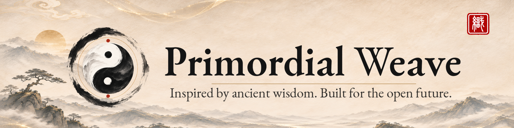

# Primordial Weave · 原初织界品牌规范

<p align="center"><strong>灵感源自古老智慧，创造面向开放未来的工具。</strong></p>

<p align="center"><a href="./README.md">English</a> · <a href="./README.zh-CN.md">简体中文</a></p>

<p align="center"></p>

Primordial Weave（原初织界）以中国传统哲学、水墨审美与开放技术协作为核心设计语言。

> **2026-11-09 正式版本：** 极简 Mark V1.0、**标准 Mark V1.2 居中版**及**崇羲篆体参考「織」印章 V1.4** 已完成视觉定稿并归档。旧 V1.1 保留历史文件；`.github` 组织主页图片尚未随本仓库自动替换。

## 正式图形素材

| 素材 | GitHub 文件 |
| --- | --- |
| 标准 Mark V1.2 居中版 | [2048px PNG](exports/png/pw-mark-standard-seal-v1.2-centered-2048.png) |
| 「織」字印章 V1.4 | [4096px](exports/png/pw-seal-zhi-chongxi-v1.4-4096.png) · [2048px](exports/png/pw-seal-zhi-chongxi-v1.4-2048.png) · [1254px](exports/png/pw-seal-zhi-chongxi-v1.4-1254.png) |
| 极简 Mark V1.0 | [透明 2048](exports/png/pw-mark-minimal-transparent-v1.0-2048.png) |
| 英文、中文、中英字标 | [英文](exports/png/pw-wordmark-horizontal-en-v1.1-2400x600.png) · [中文](exports/png/pw-wordmark-horizontal-zh-v1.0-2400x600.png) · [中英](exports/png/pw-wordmark-horizontal-bilingual-v1.0-2400x600.png) |
| GitHub 组织头像 | [1024px](exports/png/pw-github-avatar-v1.0-1024.png) |
| **当前推荐山水 Banner / OG / Social Preview** | [Banner V1.1](exports/png/pw-readme-banner-scenic-composed-v1.1-2400x600.png) · [OG V1.2](exports/png/pw-og-share-scenic-composed-v1.2-1200x630.png) · [Social V1.2](exports/png/pw-github-social-preview-scenic-composed-v1.2-1280x640.png) · [GitHub 优化 PNG（571 KB）](exports/png/pw-github-social-preview-scenic-composed-v1.2-1280x640-github-optimized.png) |
| Favicon | [PNG 与 ICO](exports/favicon/README.md) |

## 文档与复现

| 主题 | 文件 |
| --- | --- |
| 品牌定位 | [品牌规范](guidelines/brand-guidelines.md) |
| Logo 与版式 | [使用规范](guidelines/logo-usage.md) · [V1.2 居中合成规范](guidelines/MARK-COMPOSITION-SPEC-V1.2-CENTERED.md) · [机器清单](sources/logo/manifest.json) |
| 印章来源与版权边界 | [印章规范](guidelines/seal-usage.md) · [机器清单](sources/seal/manifest.json) · [QA](sources/seal/qa-v1.4.json) |
| 字体与许可 | [字体规范](guidelines/typography.md) · [授权说明](guidelines/licensing.md) |
| 山水素材记录 | [Manifest](sources/logo/scenic-exports-manifest-v1.2.json) · [QA](sources/logo/SCENIC-ASSETS-QA-V1.2.md) · [合成脚本](sources/logo/scripts/compose.py) |
| 项目路线 | [PLAN.md](PLAN.md) · [CHANGELOG.md](CHANGELOG.md) |

```bash
python3 -m pip install -r sources/logo/scripts/requirements-v1.4.txt
python3 sources/logo/scripts/compose_seal_and_mark_v1_4.py
python3 sources/logo/scripts/verify_assets_v1_4.py
```

合成结果保存在 `build/v1.4/`，不覆盖正式 PNG。当前「織」字为参考小图描摹的已确认 SVG 轮廓，**并非使用实际崇羲字体文件排印**，不能视为字体版权核验或古文字学认证；公开仓库也不等于开放品牌图形商用授权。

**2026-11-10 核对：** 新版山水 Banner、OG、Social Preview 与优化版已经上传 `brand/exports/png/`，且与交付文件逐字节一致。通过 `python3 sources/logo/scripts/compose.py` 可输出至 `build/scenic-v1.2/`，不覆盖已入库 PNG。**注意：** 组织 `.github/profile/README` 仍引用 `.github/assets/primordial-weave-banner.png` 旧版文件，仓库上传不等于组织主页已更新。
